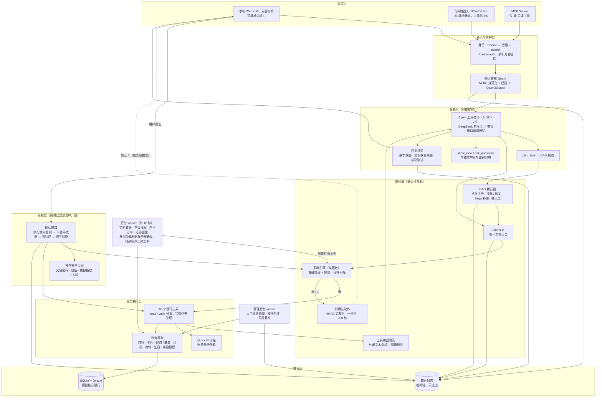
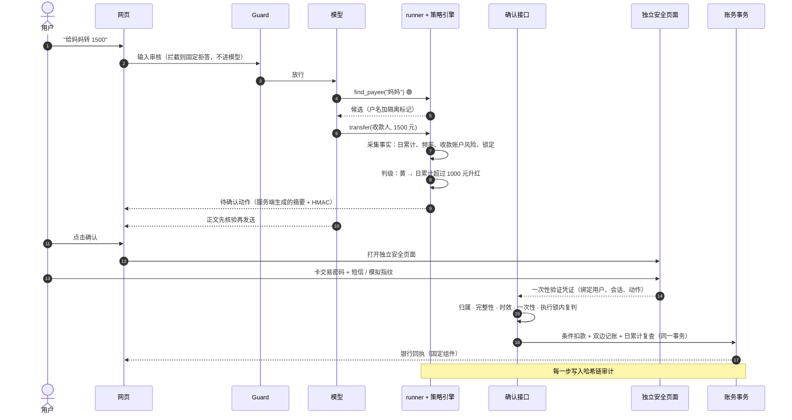
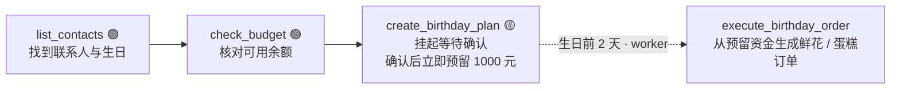

# 文财 · 银行 AI 智能体 —— 系统架构

> 版本 v1.1 · 2026-10-28，依据当日 `main` 源码整理。
> 本文是参赛「技术文档」中的系统架构部分。安全机制的完整说明与已知缺陷见 [SECURITY.md](SECURITY.md)，核心算法见 [ALGORITHMS.md](ALGORITHMS.md)，赛题逐项对应见 [COMPETITION-COMPLIANCE.md](COMPETITION-COMPLIANCE.md)。内容与代码不一致时以代码为准。

## 0. 设计原则

**大模型负责"理解与提议"，确定性代码负责"授权与执行"。**

模型的输出被视为**不可信的提议**：它可以决定"想调用哪个工具、传什么参数、怎么展示"，但不能决定"风险等级是什么、要不要确认、是否允许执行"。所有涉及资金和账户状态的决定都由纯代码的策略引擎做出，并在服务端强制执行。

由此推出四条硬约束：

1. **风险等级只能由代码判定，且只升不降**——提示词里写什么都不影响分级。
2. **模型没有"确认"能力**——系统中不存在任何可被模型调用的确认、放行或验证工具；确认只能来自已登录用户在确认卡和独立安全页面上的操作。
3. **关键数据不经模型转述**——余额、确认单、回执、理财建议由服务端数据渲染为固定组件。
4. **外部文本一律视为数据**——用户输入、交易备注、他人户名、AA 事由等进入模型前经过审核与隔离标记。

评估新功能的两条判据：**模型可以提供"事实"，不能提供"策略"**；**模型生成的文本永远不能成为证据**。

---

## 1. 系统架构图



图中只有"用户点击 → 确认接口"一条路径能让黄色、红色操作真正执行。模型可以调用的所有路径都止于"生成待确认动作"。

### 1.1 一笔转账的完整链路



---

## 2. 技术选型

| 层 | 选型 | 版本 | 理由 |
|---|---|---|---|
| 全栈框架 | TanStack Start + React 19 + Tailwind 4 | 1.168 | 前后端同仓，server route 直接承载 API；一条命令启动 |
| 界面组件 | shadcn / Base UI + Motion + Recharts | — | 无障碍组件；桌面与手机两套布局，支持深色模式 |
| 模型编排 | Vercel AI SDK | 7 | 工具循环、UI 消息流、流式输出转换（用于先核验再发送） |
| 主模型 | DeepSeek（`DEEPSEEK_MODEL`，默认 `deepseek-flash`） | — | 中文理解与工具调用；温度 0.2，单轮最多 8 步 |
| 备用模型 | OpenAI 兼容接口（`FALLBACK_*`） | — | 主模型在开始响应前失败（连接错误、限流、15 秒无响应）时自动切换，失败模型冷却 60 秒 |
| 注入审核 | 规则启发式 + Qwen3Guard（可选，vLLM 自部署） | — | 两者并行、取更严结果；审核模型不可用时退回规则，不阻断业务 |
| 生成式界面 | json-render | 0.21 | 组件目录用 zod 约束，输出是可严格校验的 JSON |
| IM 渠道 | Vercel Chat SDK + 飞书官方适配器 | chat 4 | 长连接免公网回调；交互卡片 |
| 开放协议 | MCP（`@modelcontextprotocol/sdk`） | 1.32 | 只读银行能力可被 OpenClaw 等通用智能体调用 |
| 数据库 | SQLite（libsql）+ Drizzle ORM | — | 单文件零运维；用户执行锁与有界重试处理多进程写入 |
| 认证 | better-auth（手机号验证码、会话存库） | 1.7 | 会话、设备踢出、认证接口限流与 CSRF 开箱可用 |
| 强验证 | 每卡 scrypt 交易密码 + 短信 + 模拟指纹 / 人脸；保留 WebAuthn | — | 独立安全页面完成，模型不接触任何凭据 |
| 代码沙箱 | quickjs-emscripten | 0.32 | WASM 隔离：无文件系统、网络，限时、限内存 |
| 基金数据 | 天天基金公开接口 + 离线快照 | — | 远程 JS 只当文本解析，绝不执行 |
| 测试 | Vitest | 5 | 81 个测试文件、1077 项 |

---

## 3. 模块划分

```
src/
  server/
    agent/        Agent 主流程（run.ts）、系统提示词、工具集装配、多笔转账、会话快照
    llm/          模型注册与运行时故障切换
    guard/        输入审核：规则启发式、Qwen3Guard、组合
    verify/       回复核验：金额与尾号出处、流水联合核验、成功陈述
    genui/        生成式界面与选择模板的校验
    tools/        银行工具定义（89 个）、runner.ts 唯一入口、输出清洗与隔离标记
    policy/       策略引擎（纯函数）、规则、事实采集、北京时间日累计
    confirm/      待确认动作：HMAC 完整性、执行锁、确认与回执
    planner/      DAG schema 与校验（拓扑排序、环检测）
    executor/     DAG 执行器：挂起 / 恢复、暂停、补偿、转人工
    auth/         强验证、交易密码、短信挑战、模拟生物验证、Passkey、渠道绑定
    security/     独立安全页面、卡凭证要求、请求来源校验、安全内核演示、决策链追踪
    audit/        哈希链审计
    payments/     转账结算、AA、投资冲正
    cards/        卡片服务、卡号加密、每卡密码
    funds/        基金数据接入、九周期指标、未知价申购、理财专家
    life/         生活商城与订阅
    automation/   定时任务、订阅识别与提醒、生日计划、常设授权
    risk/         收款账户风险分析（SQL 特征 + 模型判断）
    profile/      后台用户画像（只读）
    sandbox/      QuickJS 沙箱
    channels/     飞书、MCP
    admin/        后台访问控制、运行日志
    logging/      脱敏的运行时日志
    db/           Drizzle schema、种子数据
  components/     银行首页、聊天、确认卡、理财、商城、后台
  routes/         页面与 API（/api/chat、/api/confirm、/api/plans、/api/secure-operation 等）
scripts/          worker、飞书机器人、MCP Server、启动脚本
tests/            81 个测试文件（策略、确认、注入、幻觉、越权、并发、沙箱、DAG 等）
```

依赖方向：渠道 → agent → tools/runner → policy / confirm → 业务服务 → db。前端不引用服务端代码。已知的循环依赖与拆分计划见 [HANDOFF.md §6](HANDOFF.md)。

---

## 4. 权限分级与确认

| 等级 | 策略 | 典型操作 |
|---|---|---|
| 🟢 绿 | 自动执行 | 所有只读工具：余额、流水、账单分析、理财 / 基金查询、预览类工具 |
| 🟡 黄 | 用户确认（动用银行卡或资金账户时另需一次付款凭证） | 小额转账、锁卡、订阅取消、申请新卡、AA 发起、定时转账 |
| 🔴 红 | 强验证 | 日累计超过 1000 元的转账、挂失、解锁、调额、理财 / 基金申购、赎回、AA 付款、常设授权 |

- 转账的黄 / 红界限沿用赛题示例：按北京时间自然日，统计本人全部账户**转给他人**的金额（含本笔），≤ 1000 元为黄色，> 1000 元为红色。本人账户、本人银行卡之间互转和信用卡还款不计入、也不触发这条规则（与 2026-10-28 赛事答疑口径一致）。
- 收款账户被标记可疑时直接升为红色；它与单笔超过 3000 元一样，还会把红色的第二步验证限定为指纹或人脸。两者都不增加新的等级。
- 每个工具声明基础等级；策略引擎根据服务端采集的事实逐条应用规则，**只升不降**，命中原因写入审计并展示给用户。
- 确认时在用户执行锁内重新采集事实、重新判级；扣款事务内再核一次日累计（本人互转除外）和收款账户风险。
- 渠道能力上限：Web/H5 到红色；飞书到黄色，超出时回复原确认单的 H5 链接；MCP 只读。

规则全表、验证方式矩阵、确认链路的校验顺序见 [SECURITY.md §3–§4](SECURITY.md#3-权限分级)。

---

## 5. 意图理解与任务规划

- **工具循环**：模型在一轮内最多调用 8 步工具；确认结果核对轮次只开放只读工具，不能借"核对"再次发起写操作。
- **补全与澄清**：可选择的业务条件用模型即时生成的问卷（1–12 题）收集，真实对象（银行卡、收款人、商品）用选择组件，精确金额等自由输入直接追问；已知信息不重复问。
- **消歧**：收款人按姓名、备注名、手机号、卡号后四位打分匹配；本人银行卡按备注或尾号匹配，重名必须追问尾号，模型不能自行挑选。
- **DAG 规划**：复杂任务由模型调用 `plan_task` 提交 `{goal, nodes:[{id, kind, tool, args, dependsOn}]}`，参数可用 `{"$ref":"n1.字段"}` 引用直接依赖的输出。校验通过后由执行器拓扑执行，遇到需要确认的节点挂起，确认后从断点恢复；失败或取消时逆序补偿。
- **中断与接管**：对话停止按钮让计划停在两个节点之间并保存为"已暂停"；任务中心可暂停、恢复、取消、记录人工处理结果；`handoff` 节点转人工。

示例——"我爱人下个月生日，帮我准备一下"：



算法细节见 [ALGORITHMS.md §3](ALGORITHMS.md#3-任务-dag-执行与补偿)。

---

## 6. 生成式界面分层

| 类别 | 例子 | 实现 |
|---|---|---|
| ① 安全关键 | 确认卡、强验证、回执、余额、银行卡、理财建议卡 | 固定 React 组件，只渲染服务端数据，**模型不参与** |
| ② 展示类 | 账单看板、产品对比、消费趋势 | 模型调用 `show_view` 提交 json-render spec → 组件目录校验 + **禁止数字字面量** + 数据路径必须存在 → 服务端注入数据快照 → 客户端渲染 |
| ③ 选择与问卷 | 选付款卡、选收款人、补充偏好 | 选择组件只暂存，由统一确认入口以用户身份发送完整需求；问卷提交不等于授权 |
| ④ 文本 | 解释、追问 | Markdown，发送前核验金额与成功陈述 |

任何写意图都会变成一条新的用户消息，重新走"理解 → 判级 → 确认"。

---

## 7. 后台进程与部署

**worker**（`scripts/worker.ts`，每 10 秒一轮）：同步仿真时钟 → 确认基金份额 → 每晚 20–23 点（北京时间）刷新基金净值 → 逐个用户执行到期定时转账、常设授权、商城续费、订阅提醒与识别 → 收款账户风险分析。到期的定时转账和生日订单用同一套事实采集（`collectFacts`）与策略引擎（`decide`）按执行时事实重新判级，超出原授权等级时创建新的待确认动作，要求用户重新确认。

**部署**：Docker 镜像，`compose.production.yml` 编排 `web`、`worker`、演示短信服务，经反向代理提供 HTTPS；详见 [GOOGLEVM.md](GOOGLEVM.md)。本地开发用根目录 `start.bat` 同时启动网页与 worker，见 [DEVELOPMENT.md](DEVELOPMENT.md)。

| 部署约束 | 说明 |
|---|---|
| 单实例 | 生成式界面快照、Passkey 挑战、飞书对话历史、后台转账授权在进程内存中，多实例需改为共享存储（SECURITY §18 #11） |
| 演示开关 | 模拟指纹 / 人脸需要显式设置 `AUTH_DEMO_MODE=true`；生产构建默认关闭 |
| 密钥 | 生产强制要求 ≥ 32 位独立随机的 `CONFIRM_SECRET` |

---

## 8. 场景覆盖与已知边界

六个赛题场景全部覆盖，逐项对应见 [COMPETITION-COMPLIANCE.md §2](COMPETITION-COMPLIANCE.md#2-六个场景赛题要求至少-3-个本作品全部覆盖)。

已知边界（详见 [SECURITY.md §18](SECURITY.md#18-未完成项与已知缺陷)）：基金暂不支持赎回；数字核验暂不识别"万"和中文数字；只审核最后一条用户消息；审计哈希链未加密钥；飞书、Passkey 实机、MCP OAuth 尚未在真实环境验收；指纹 / 人脸为模拟按钮。
