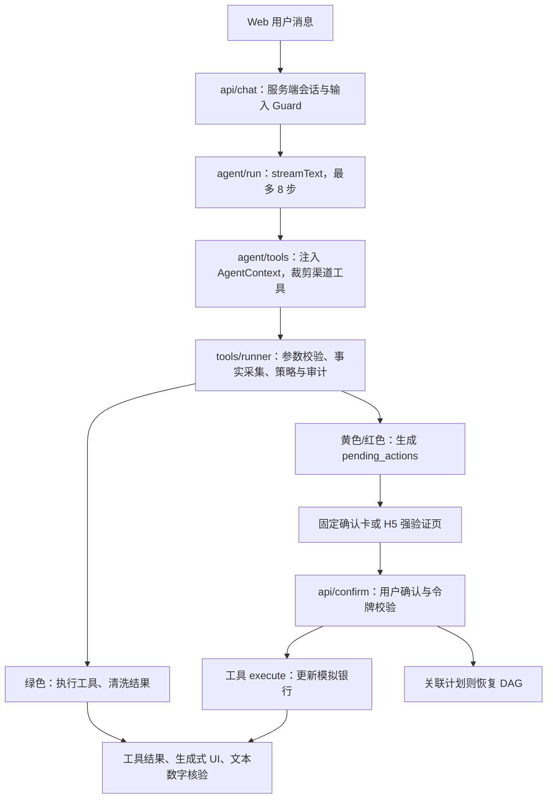

# 文财开发导读

> 2026-10-12 根据当前源码梳理。本文描述实际实现；[ARCHITECTURE.md](ARCHITECTURE.md) 保留整体设计与目标。模拟银行数据不连接真实银行。
>
> **接手开发请先读 [HANDOFF.md](HANDOFF.md)**：四条硬约束、代码地图、两类令牌的区别、排查坑点与当前任务优先级。本文偏"现有实现怎么走"，HANDOFF 偏"改之前必须知道什么"。

## 1. 项目形态与入口

这是一个单仓全栈 TypeScript 应用，没有独立的 Python 服务或银行后端。React 19、TanStack Start 文件路由、Vite、Tailwind 4 承载页面与服务端 API；AI SDK 负责模型工具循环；Drizzle + libSQL/SQLite 保存业务和认证状态。

| 入口 | 代码 | 作用 |
|---|---|---|
| 用户首页 `/` | `src/routes/index.tsx`、`src/components/banking/BankingHome.tsx` | 资产、收支、卡片、最近交易、底部导航和悬浮 Agent |
| 用户首页 API | `src/routes/api/dashboard.ts` → `src/server/dashboard.ts` | 从登录会话读取身份，汇总本人数据；金额返回元，禁止共享缓存 |
| 转账与收款人 | `src/components/banking/PaymentCenter.tsx`、`src/routes/api/payments.ts` → `src/server/payments/service.ts` | 手机号/账号户名查找、确认添加、双边转账、本人互转与收款账号 |
| Agent 面板 | `src/components/chat/ChatView.tsx`、`ToolPart.tsx` | 流式消息、固定回执、生成式视图和交易确认 |
| 聊天 API | `src/routes/api/chat.ts` | 认证、输入审核、流式 Agent 调用 |
| 确认 API / 页面 | `src/routes/api/confirm.ts`、`src/routes/confirm.$actionId.tsx` | 用户确认、强验证、DAG 恢复 |
| 登录 / 安全设置 / 绑定 | `src/routes/login.tsx`、`settings.tsx`、`bind.tsx` | 手机号验证码、设备、Passkey、飞书绑定 |
| 银行演示后台 `/admin` | `src/routes/admin.tsx`、`src/components/admin/` | 用户首页、按账户切换、8 个运营视图、人工操作、仿真时钟 |
| 后台 API | `src/routes/api/admin.ts` | 快照、报表、异常、直接业务命令 |
| 飞书 | `scripts/lark-bot.ts` → `src/server/channels/lark.tsx` | 绑定身份后的对话与确认卡 |
| MCP stdio | `scripts/mcp-server.ts` → `src/server/channels/mcp.ts` | 为本地调用方注册只读工具 |

`src/router.tsx` 将路由与 TanStack Query 接起来。`src/routeTree.gen.ts` 是生成文件，新增路由后运行 `pnpm generate-routes`，不要手工维护它。

## 2. 主调用链



- `AgentContext = { userId, sessionId, channel }` 由服务端创建并通过闭包传给工具，模型不能指定用户身份。
- `agent/run.ts` 只负责模型编排和输出核验；业务规则应写在工具、策略或业务辅助函数中。
- `tools/runner.ts` 是 Agent 工具调用的统一授权入口；绿色直接执行，黄色/红色生成待确认动作。
- `policy/engine.ts` 是无 I/O 的纯函数。`policy/facts.ts` 从数据库取事实，`policy/rules.ts` 决定升级或拒绝，等级只升不降。
- `confirm/pending.ts` 校验动作归属、HMAC、过期、状态及红色强验证，再原子消费待确认动作并调用工具。
- `audit/log.ts` 串行追加哈希链；`guard/` 清理注入文本；`verify/numbers.ts` 为回复中的关键数字检查出处。

## 3. 工具体系与两类令牌

当前 `BANK_TOOLS` **89 个**，其中 54 个 read、35 个 write，工具名称无重复（2026-10-25；README 计数由 `tests/tool-catalog-docs.test.ts` 自动核对）。覆盖基础、扩展、计划、支付、卡片、AA、订阅、生日、常设授权、生活商城与基金工具。Web/飞书 Agent 暴露其中 88 个（排除旧 `request_password_change`），另注册 `ask_questions`、`prepare_interaction`、`prepare_transfer_batch`、`plan_task`、`show_view`；MCP 只注册 54 个 read 工具。

| 文件 | 负责内容 |
|---|---|
| `src/server/tools/define.ts` | 工具契约：Zod 参数、基础风险、确认摘要、执行、可选补偿 |
| `bank.ts` | 基础查询、转账、卡片与订阅；合并工具数组并提供 `resolveTool` |
| `bank-extended.ts` | 报表、异常、实体解析、预校验、转账/理财/卡片/订阅的 preview 与 commit |
| `bank-planning.ts` | 联系人、持仓、预算与排期、测评、定时转账、AA、提醒、计划取消 |
| `jobs.ts` | 仿真时间、风险测评评分、到期定时转账执行 |

两类令牌用途不同，开发时不要混用：

1. **业务预览令牌 `confirmation_tokens`**：`preview_*` 签发，`commit_*` 消费；绑定用户、操作类型和解析后的参数指纹，默认 15 分钟有效。它保证提交参数与预览一致，不代表用户已授权。
2. **用户确认动作 `pending_actions`**：由策略包装层创建；HMAC 绑定动作、用户、工具、参数、风险与过期时间，默认 300 秒有效。只能通过已认证用户确认（Web API 或飞书按钮）继续，红色还要绑定手机短信或要求用户验证的 Passkey。

典型扩展转账：`resolve_recipient` → `check_transfer_limit` → `preview_transfer` → `commit_transfer` → 待确认 → 用户确认 → 校验/消费业务令牌 → 转账。

基础 `transfer`、扩展 `commit_transfer`、本人 `transfer_between_accounts` 和后台/到期任务共用 `payments/service.ts` 结算。转账策略同时识别元和分；新增收款人转账需要红色强验证。

`SYSTEM_TOOLS` 包含 `advance_simulation_clock`、`run_due_jobs`，没有合入 `BANK_TOOLS`，不暴露给模型。预览工具虽标为 read，仍会写入技术性的预览令牌记录；这里的 read 指不执行资金/账户业务变更。

## 4. DAG 与生成式 UI

- `planner/dag.ts` 校验节点、工具白名单、直接依赖引用和环；参数支持 `{ "$ref": "n1.field" }`。
- `executor/executor.ts` 是可测试的状态机：就绪节点推进，需确认的分支挂起，其他就绪分支继续；失败/取消时逆序尝试补偿。
- `executor/service.ts` 连接工具与数据库，将状态保存到 `plans`；Web 确认 API 根据 `planId/nodeId` 恢复或取消计划。
- 不是每个 write 工具都有补偿；缺失补偿或补偿失败时计划会进入 `failed`，不能承诺所有流程都自动回滚成功。
- `genui/catalog.ts` 与 `genui/registry.tsx` 定义展示组件。`server/genui/validate.ts` 校验组件、数据路径和数字出处，丢弃模型自带 state，再注入服务端工具结果。
- `agent/session.ts` 的工具结果快照是进程内 Map；Web 消息历史由客户端随请求提交，飞书历史保存在进程内 Map。

### 用户界面与动效复用

用户端采用蓝白配色，样式限定在 `components/banking/banking.css`，不改变演示管理后台。首页数据以整数分汇总后转为元，资产为活期余额与理财本金之和；首页月度/近六个月统计和 `get_spending_report` 使用 UTC+8 账期。`analyze_spending` 仍按最近若干天计算，两者标题明确区分。

| 共用组件 | 用途与动效 |
|---|---|
| `ui/motion.tsx`、`motion.css` | `Reveal` 首次进入可视区域时入场；`AnimatedAmount` 金额过渡；`.bank-lift` 悬停、聚焦和按压反馈 |
| `ui/BankCard.tsx` | `BankCard` 立体前推与掠光；`BankCardStack` 分层入场与悬停前推 |
| `ui/charts.tsx`、`charts.css` | `AnimatedBarChart` 从底部逐柱展开；`AnimatedDonutChart` 按真实比例顺时针绘制，可选 `pie` 实心饼图 |
| `banking/FinancialReport.tsx` | 共享支出合计与环图/柱图切换，用于首页和 Agent 固定工具输出 |
| `ui/Sheet.tsx` | 可开合底部面板、Escape 关闭、焦点约束与归还；关闭时保留对话并设置 `inert` |
| `ui/DraggableFloatingButton.tsx` | Pointer Events 拖动、点击与拖动区分、页面边界约束；面板关闭后保留位置，窗口缩小时自动调整 |

新增业务图表时直接复用，不要另写一套动画：

```tsx
import { AnimatedBarChart, AnimatedDonutChart } from '#/components/ui/charts'
// data 来自服务端工具结果或 /api/dashboard，value 单位为元。
const data = categories.map(({ category, total }) => ({ label: category, value: total }))
<AnimatedBarChart title="分类支出" data={data} />
<AnimatedDonutChart title="支出占比" data={data} />
```

图表首次可见时播放，数据内容变化才重新播放，同一份数据的流式刷新不会重播。标签、金额和占比支持键盘聚焦读取，空数据展示空状态；系统设置 `prefers-reduced-motion: reduce` 时直接显示最终图形与金额。`genui/registry.tsx` 的 `BarChart`、`PieChart` 也使用这些组件，仍须经过服务端 `$state` 与数字出处校验。已有生成式视图引用的工具数据折叠为完成提示，避免重复呈现同一张分析图；交易确认单始终保留。Agent 完成、交易确认成功和面板关闭都会刷新首页数据。

## 5. 数据与金额约定

| 数据组 | 表 |
|---|---|
| 认证 | Better Auth 的 user/session/account/verification、Passkey 表（`db/auth-schema.ts`） |
| 银行业务 | `users`、`accounts`、`payees`、`transactions`、`cards`、`subscriptions`、`products` |
| 扩展业务 | `contacts`、`holdings`、`scheduled_tasks`、`splits`、`birthday_plans`、`birthday_orders` |
| 授权与执行状态 | `channel_bindings`、`pending_actions`、`confirmation_tokens`、`plans` |
| 系统 | `settings`（含全局仿真时钟）、`audit_logs` |

schema 定义在 `src/server/db/schema.ts`；`db/client.ts` 合并业务与认证 schema。当前使用 `drizzle-kit push` 同步结构，没有已提交的版本化迁移目录。

- 存库金额为整数分。基础工具常用 `amount`（元）；扩展工具使用 `amountCents`（分），返回给 Agent 时又可能换算为元。
- 后台 API 的 `balance/amount/budget` 等展示字段多数仍是分，前端 `components/admin/utils.ts` 的 `money()` 再除以 100；不要直接复用为 Agent 返回值。
- 时间既有 SQLite `timestamp_ms`，也有 ISO 字符串；仿真时间由 `settings.clock` 读取，种子时钟为 `2026-10-11T02:00:00.000Z`。策略和令牌部分仍使用真实时间。
- `seed.ts` 会清空并重建演示数据，再调用 `seed-extended.ts`；不要把 `pnpm db:seed` 当作无损增量初始化。

## 6. 本地运行与验证

要求 Node.js >= 22、pnpm，在项目根目录执行。Windows 推荐双击 `start.bat`，由 `scripts/start-local.mjs` 加载 `.env.local`，检查依赖，仅在数据库文件不存在时建表与播种；服务启动成功后自动打开页面。控制台实时显示日志，并保存到 `.scratch/logs/run-*.log`，模型密钥与签名密钥会在输出中隐藏。Agent 日志包含请求编号、工具名称、步骤状态、用量与耗时，不记录完整对话或账户明细。按 `Ctrl+C` 结束服务；`start.bat --no-open` 可用于不打开浏览器的启动检查。

日志单文件最多 10 MB，每次运行最多保留当前文件与三个滚动文件（`.log.1`～`.log.3`）；超长单行会截断。开发配置关闭了浏览器与服务器之间的双向控制台转发，以防日志回路，服务端日志仍直接进入启动窗口与文件。

服务端 `env.ts` 和 Drizzle 配置读取 **process.env**；手动启动时需要显式加载环境文件。下面适用于当前 Windows PowerShell：

```powershell
pnpm install --frozen-lockfile
Copy-Item .env.example .env.local
# 编辑 .env.local：填写至少 16 位的 CONFIRM_SECRET，以及 DEEPSEEK_API_KEY
# 或填写 FALLBACK_BASE_URL / FALLBACK_API_KEY / FALLBACK_MODEL
New-Item -ItemType Directory -Force data | Out-Null
pnpm exec node --env-file=.env.local ./node_modules/drizzle-kit/bin.cjs push
pnpm exec node --env-file=.env.local --import=tsx src/server/db/seed.ts
pnpm exec node --env-file=.env.local ./node_modules/vite/bin/vite.js --port 3000
```

环境变量已由终端或运行平台注入时，可直接使用 `pnpm dev`、`pnpm db:push` 等快捷命令。现有 `db:reset` 包含 POSIX 的 `mkdir -p`/`rm -f`，不适合直接在 Windows 默认命令环境运行；上述建表与播种步骤适合首次初始化，保留已有数据时不要播种。

页面：`http://localhost:3000/`（用户端）、`/admin`（银行工作人员的运营管理后台，`components/admin/console/`）。地址参数 `section`（dashboard / callbacks / fraud / risk / customers / customer / security / logs / demo）加可选的 `userId`、`tab`、`ticket`、`event`。全局汇总走 `/api/admin-console`，单个客户的数据仍走 `/api/admin`（GET 带 `userId`，POST 带 `x-admin-user`）。旧版单客户工作台只在演示控制里以 `section=demo&userId=…` 打开。

后台检查 `ADMIN_ENABLED`；工作人员用 `ADMIN_STAFF_ACCOUNTS` 预置的工号密码登录（`/api/admin-session`，签名 Cookie），演示模式不再免登录；脚本调用可用 Bearer `ADMIN_TOKEN`；只有未配置 `ADMIN_TOKEN` 的本机开发环境可免登录。生产默认关闭后台。飞书、MCP 启动脚本同样要注入所需环境变量。

验证命令：`pnpm typecheck`、`pnpm build`、`pnpm test`。数据库测试依赖已有表结构，应指向独立库；当前 `vitest.config.ts` 禁用文件并行，以避免 SQLite 写冲突。

独立测试库示例（在新的 PowerShell 终端执行）：

```powershell
New-Item -ItemType Directory -Force .scratch | Out-Null
$testDb = 'test-' + [guid]::NewGuid().ToString('N') + '.db'
$env:DATABASE_URL = 'file:./.scratch/' + $testDb
pnpm exec drizzle-kit push --force
pnpm db:seed
pnpm test
Remove-Item Env:DATABASE_URL
```

2026-10-11 核验结果：类型检查通过；客户端和服务端生产构建通过（有大于 500 kB 的客户端包体提示）；独立库上 **16 个测试文件、120 项测试通过**，含后台用户切换、首页数据归属、UTC+8 跨月/跨年统计、生成式图表数据解析和固定工具视图。浏览器验证了手机/桌面布局、资产隐藏、卡片、账单图表切换、逐柱/逐弧动画、减少动态效果、面板开合和键盘关闭；生成式视图联调使用独立本地模型协议夹具调用真实工具，不替换产品认证或业务数据。另使用真实 DeepSeek `deepseek-flash` 验证了模型鉴权、文本回复，以及演示用户登录后 `/api/chat` 的 `get_accounts` 工具调用和余额回复；Windows BAT 已验证全新独立库初始化与服务启动。飞书、图片输入和移动端 Passkey 尚未完成真实服务端到端联调。

## 7. 后续修改从哪里入手

| 开发需求 | 修改入口 | 验证重点 |
|---|---|---|
| 新银行动作 | `tools/define.ts` 契约、业务工具文件、`bank.ts` 注册 | 参数、归属、风险、确认摘要、补偿；需要两段式时增加 preview/commit |
| 新风控规则 | `policy/types.ts`、`facts.ts`、`rules.ts` | 为每条实际工具路径覆盖升级/拒绝，不只测纯策略函数 |
| 新后台功能 | `routes/api/admin.ts`、`components/admin/client.ts`、`actions.ts`、`views/` | 金额单位、操作审计、错误与刷新 |
| 新展示组件 | `genui/catalog.ts`、`registry.tsx`、服务端校验 | 只能引用服务端数据，不能执行写操作 |
| 新用户端数据卡/图表 | `components/ui/`、`banking/`、`server/dashboard.ts` | 复用动效；校验数据归属、金额单位、空状态与减少动态效果 |
| 新渠道 | `channels/`、服务端身份解析、工具白名单 | 渠道绑定、能力上限、确认后恢复 |
| 新数据库字段 | schema、seed、相关查询 | 独立库同步结构，更新测试；未来引入版本化迁移 |
| 调整模型/提示词 | `llm/models.ts`、`agent/instructions.ts` | 配置模型 ID 后验证真实服务、工具调用、流式协议 |

建议阅读顺序：`api/chat.ts` → `agent/run.ts` → `agent/tools.ts` → `tools/runner.ts` → `policy/` → `confirm/pending.ts` → 一个完整 preview/commit → `executor/` → 对应 UI。

## 8. 当前实现边界与优先事项

本轮已修复风险分级绕过、确认时风险过期、并发申购/赎回、密码默认兜底、飞书确认不恢复 DAG、AA 伪到账、生日预算占位、自动任务与订阅提醒缺失等问题。实现与验收边界见 [COMPETITION-COMPLIANCE.md](COMPETITION-COMPLIANCE.md)。

仍须区分本地功能测试与外部验收：真实短信需要配置发送适配器；Passkey 需要实际设备完成注册与验证；飞书需要应用凭据、权限及回调配置。生日订单、信用授信及外部银行转账均为模拟，不连接真实商户或银行。没有可靠事务标记的旧版 processing 任务不可自动重跑，必须人工核对旧流水。

生成式 UI 快照、飞书对话历史与 Passkey challenge 仍在进程内，正式多实例部署需共享持久化；当前后台令牌是演示访问凭据，不是完整管理员角色系统。空闲超时策略、真实客服工单等仍属于后续生产化范围（主模型开始响应前失败的自动切换已于 2026-10-12 实现）。已知缺陷的完整清单以 [SECURITY.md §18](SECURITY.md#18-未完成项与已知缺陷) 为准。

> 以下按日期的小节是**历史变更记录**，描述的是当时的实现（例如 10-12 的"强验证改为短信 / Passkey"已被每卡交易密码与模拟指纹 / 人脸取代）。现行规则以 [SECURITY.md](SECURITY.md) 与代码为准。规则拦截与数字核验不能证明模型在所有输入下都无幻觉，提交前应补充对抗用例与真实设备/渠道演示。

## 转账与收款人（2026-10-11）

- 首页“转账”、账户页“转账 / 本人互转”、收款人入口打开 `PaymentCenter`；“收款”显示本人的完整文财账号，可复制账号与户名。
- `GET /api/payments` 仅返回会话本人的可转账资金账户与收款人，信用卡走还款服务；POST 使用明确的支付、卡片管理工具白名单，用户身份来自会话。写操作经同一策略引擎生成确认单，仍由 `/api/confirm` 执行。
- 按完整 11 位手机号或完整 16 位文财账号＋户名查找。多账户候选必须由用户选择，不返回他人余额；签名候选绑定发起者、账号、户名及 15 分钟有效期。
- 新增文财收款人绑定真实账户 ID。确认转账后 A 扣款、B 入账，写两条关联流水；本人互转仅允许本人不同账户。原有外部银行卡收款人保留模拟转出，不接真实银行。
- 三张扩展表存储稳定账号、收款人关联、双边流水与冲正状态；首次使用自动 `CREATE TABLE IF NOT EXISTS` 升级，保留已有数据库余额与历史。
- 本地 SQLite 客户端请求排队避免连接池在事务 await 期间争锁；事务回调必须只使用 tx，不能调用外层 db。数据库条件扣款与唯一约束是最终保障；跨进程通过数据库用户租约、事务与有界锁冲突重试协调；事务回调只能包含数据库操作，不得执行网络请求等外部副作用。
- 收款账号是文财模拟系统的独立 16 位账号，不是旧银行卡装饰尾号。手机号查找仅支持已注册并有人民币账户的文财用户；注册后没有银行账户时无候选。
- 自动测试：17 个文件、132 项通过；含手机号/账号户名、候选签名隔离、确认与密码、并发、双边流水与冲正、扩展令牌重放、并发定时任务和精确金额输入。

## Agent 结果展示与模型协议（2026-10-11）

- `agent/tool-schema.ts` 为银行工具参数补充根节点 `type: object`，保留联合分支及原有 Zod 运行时校验；避免 DeepSeek 因收款人查询的根联合类型拒绝整个对话请求。
- `chat/presentation.ts` 统一选择每条回答的最终视图。流式处理期间查询结果仅显示进度；回答结束后，生成式视图优先，相同分类数据的固定报表及重复生成视图折叠。视图失败时使用可用固定报表兜底；不同账期、多图对比、历史回答、确认卡和银行业务错误保留。
- `get_spending_report` 保留原有 `categories` 字典，并提供按金额排序的 `byCategory: {category,total}[]`；自然月图表直接引用该数组，避免额外调用近三十天分析转换格式。
- 图表与银行卡在最终结果确定后挂载，继续复用共享组件动画；新增测试覆盖 DeepSeek SDK 实际请求参数、联合分支校验、图表去重、流式隐藏、失败兜底和独立账期。
- 验证：19 个测试文件、147 项通过，类型检查与生产构建通过；真实 DeepSeek 完成“本月支出分类图”和账户查询，手机端确认处理中无图表、结束后仅一个分类图。

## Agent 文字表格（2026-10-11）

- `chat/AssistantText.tsx` 接管 Markdown 表格，复用银行表格样式，关闭表格复制/下载/全屏工具栏；全局 Tailwind 补充 Streamdown 样式扫描路径。
- 仅与当前回答实际挂载的生成式 Table 比较表头和完整明细，识别金额格式、日期缩写、列顺序和行排序差异；相同明细不重复显示。不同交易、额外字段及未被卡片覆盖的表格继续渲染；正文结论与代码保留。流式中的文字表格等待回答结束后显示。
- 提示词要求生成式结果之后只给简短结论；“列出几笔交易”优先明细表，不主动追加图表。20 个文件、156 项自动测试通过，覆盖截图中的重复明细及纯 Markdown 兜底。

## 单卡账户页与确认闭环（2026-10-12）

- `AccountCarousel` 使用水平滚动吸附，支持触屏滑动、鼠标拖动、方向键及切换按钮；选择按卡片 ID 保留。银行卡通过独立的 `accountId` 关联账单，旧版共用账户的卡片由下述升级服务拆分。
- `/api/dashboard` 返回本人各账户的 `accountActivity`，月度汇总从完整流水计算，各账户分别保留最近 50 笔，不从首页截断的列表筛选；无交易、无账户和金额隐藏均有对应状态。
- 所有底部窗口共用 `Sheet` 顶部拖拽条：跟手移动、短拖回弹、足量下拉或快速下拉收起，保留键盘关闭、焦点约束和对话子树。内容区滚动不会触发关闭。
- `ConfirmCard` 使用独立浅色主题，完成、取消和失败状态分别呈现；强验证改为绑定手机短信 / Passkey。防止验证期间重复点击，业务执行失败的已消费确认单不再允许重试执行。
- `useConfirmAction` 仅在服务端确认成功时发布操作编号与归属通知，同页及同源 H5 页面均可通知 Agent；失败和取消不发布。`ChatView` 按编号去重，忙碌时排队，失败可重试核对。
- 自动消息显示“我已核对并确认，请帮我核对执行结果。”，操作编号作为请求元数据发送。服务端按会话用户查询 `pending_actions` 与 `action_executed` 审计回执，不能把 consumed 直接认定为成功；结果核对轮次仅暴露只读工具与展示工具，禁止重复写操作或计划。
- 服务端核对结果以 `data-confirmation` 保留在对话中，并参与后续数字出处校验；表单或 H5 发起的操作在 Agent 中显示固定回执，已有确认卡时不重复展示。

## 独立银行卡、备注与信用卡（2026-10-12）

- `server/cards/service.ts` 首次读取卡片时无损升级旧库：共用账户的第一张储蓄卡保留原账户 ID、余额及全部历史流水，其余共用卡建立零余额账户。独立「储蓄账户」保留资金和流水并补齐实际储蓄卡记录；只有信用卡却含旧存款的账户保留为独立资金账户，信用卡另建零余额账户。升级事务可重复、可并发执行，不运行 seed 或重置用户数据库。
- `bank_card_profiles` 存放备注、信用总额度、待还金额、账单日与还款日。工资卡是备注，卡片类型仅 debit（储蓄卡）/credit（信用卡）。新增卡通过 `createUserCard` 建立独立账户，首页数量与轮播均来自实际卡片记录，不再用最多三张的固定图示。
- 储蓄卡：独立余额/账单、转账收款、备注、冻结/解锁/挂失、每日转出限额。点击当前卡转账会预选该付款账户；收款页优先展示当前卡。无卡资金账户仍能在其他资金账户及账户互转中访问。
- 信用卡：独立配色，显示信用总额度、可用额度、当前待还、账单日/还款日及该卡消费/还款流水。演示新卡初始信用额度 20,000 元、待还为零，账单日 10 日、还款日 28 日；这些是演示配置，不计算利息或生成真实银行账单。后台可模拟信用消费，用户端和 Agent 支持从本人储蓄卡部分/全额还款。
- 信用消费增加待还并减少可用额度；还款事务同时减少付款卡余额和信用卡待还，写双边流水，恢复额度。信用额度不计入存款余额，信用卡不能普通转入/转出；消费汇总排除信用卡还款，避免消费和还款重复计算。冻结、挂失、限额、余额及待还金额在执行事务中复核。
- `list_cards` 返回备注、尾号、关联账户及各卡资金信息；`resolve_my_cards` 按备注、类型或尾号精确查找，任何重名均返回多个候选并要求询问具体尾号。`transfer_between_cards`、`repay_credit_card` 在创建确认单前通过服务端 prepare 解析，歧义时不创建待确认动作；确认摘要包含双方尾号，实际卡片 ID/账户 ID 纳入参数签名，确认后不按可能已更改的备注重新匹配。`set_card_remark` 支持最多 30 字备注。
- `CardServices` 与 `PaymentCenter` 复用确认组件和顶部拖拽 Sheet，成功仍自动通知 Agent 进行只读回执核对。卡片备注作为外部自由文本经过 Guard 和模型隔离标记。
- 验证：22 个测试文件、178 项通过，类型检查与生产构建通过；真实 DeepSeek 验证重名追问及指定尾号后生成正确确认单，手机端验证四卡数量、切卡账单、备注确认闭环、信用卡部分还款及顶部下拉收回。所有转账/消费/还款测试使用独立 `.scratch/` 数据库。

## 赛题安全与流程修复（2026-10-12）

- `confirmPending` 在数据库用户租约内重跑风险策略，保持等级只升不降；跨日、大额累计、新收款人、卡片状态等按执行时事实判断。所有卡片挂失、解锁、授信及限额变更走红色验证。
- `/api/step-up` 签发绑定操作或新密码的验证挑战。短信仅发往已验证绑定手机号，五分钟有效、最多五次尝试、单次消费并限制发送频率；Passkey 要求 User Verification。普通交易密码不再满足红色操作，未设置密码没有默认兜底。生产强制独立随机签名密钥，认证端点启用 CSRF 与限流。
- 理财申购、赎回在事务内条件更新，返回真实结算余额；投资补偿按原流水冲正且幂等。回退失败会停止计划并允许记录人工核对，不伪造成功。审计链的读前序和写新记录在同一个事务，支持网页/worker 并发写入。
- `scripts/worker.ts` 每10秒处理已授权任务及提醒，一键启动同时运行 worker。默认业务时钟跟随真实时间，显式推进仿真时钟后切为 manual。执行时风险超过已授权等级则通知用户重新确认；未授权的旧任务不直接扣款。新版任务成功状态与结算原子提交，宕机恢复会作废孤儿确认单，避免重放。
- `detect_subscriptions` 根据周期、商户和金额识别疑似订阅，worker 提醒核对，不能把候选直接当成已确认订阅；确认后开启续费提醒或取消模拟代扣。同一期提醒去重。
- AA 参与人通过已验证手机号匹配站内账户，由参与人自己确认付款；借贷双方余额、流水及分摊进度在同一事务中更新，后台不代造到账。未注册联系人明确返回不可送达。
- 生日计划立即减少付款卡可用余额并保留预算，资产总额计入预留；取消只释放真实预留，生日前两天从预留资金生成模拟鲜花与蛋糕订单。旧版占位计划展示为尚未预留，不凭空退款或自动下单。
- `/api/plans` 与生活页任务中心支持暂停、恢复、取消及人工节点处理。Web/飞书共用确认恢复入口；后续待确认节点在对话和任务中心显示。失败计划禁止重新恢复扣款，人工处理备注独立于银行成功回执。
- 模型正文在发送到客户端前校验金额和成功陈述，工具进度仍流式显示；数字核验只信任服务端快照、本轮工具输出和服务端回执，浏览器提交的历史工具结果不作为凭证。
