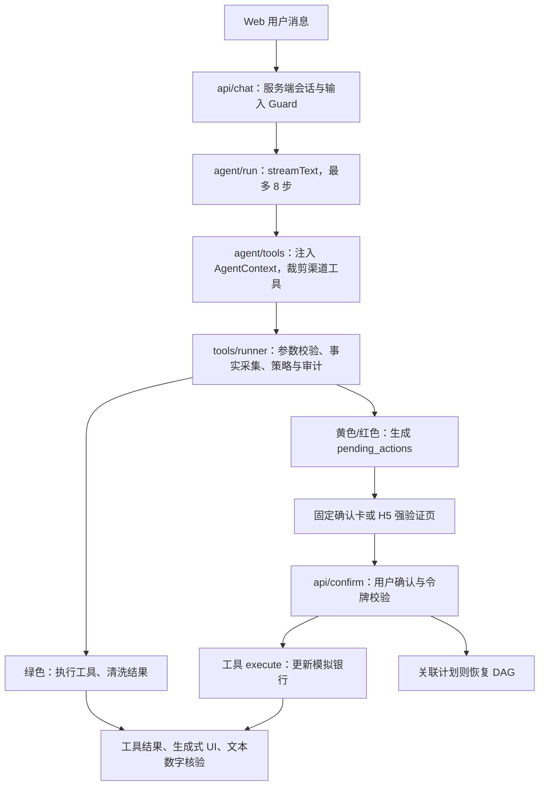

# 文财开发导读

> 2026-10-11 根据当前源码梳理。本文描述实际实现；[ARCHITECTURE.md](ARCHITECTURE.md) 保留整体设计与目标。模拟银行数据不连接真实银行。

## 1. 项目形态与入口

这是一个单仓全栈 TypeScript 应用，没有独立的 Python 服务或银行后端。React 19、TanStack Start 文件路由、Vite、Tailwind 4 承载页面与服务端 API；AI SDK 负责模型工具循环；Drizzle + libSQL/SQLite 保存业务和认证状态。

| 入口 | 代码 | 作用 |
|---|---|---|
| 用户首页 `/` | `src/routes/index.tsx`、`src/components/banking/BankingHome.tsx` | 资产、收支、卡片、最近交易、底部导航和悬浮 Agent |
| 用户首页 API | `src/routes/api/dashboard.ts` → `src/server/dashboard.ts` | 从登录会话读取身份，汇总本人数据；金额返回元，禁止共享缓存 |
| 转账与收款人 | `src/components/banking/PaymentCenter.tsx`、`src/routes/api/payments.ts` → `src/server/payments/service.ts` | 手机号/账号户名查找、确认添加、双边转账、本人互转与收款账号 |
| Agent 面板 | `src/components/chat/ChatView.tsx`、`ToolPart.tsx` | 流式消息、固定回执、生成式视图和交易确认 |
| 聊天 API | `src/routes/api/chat.ts` | 认证、输入审核、流式 Agent 调用 |
| 确认 API / 页面 | `src/routes/api/confirm.ts`、`src/routes/confirm.$actionId.tsx` | 用户确认、强验证、DAG 恢复 |
| 登录 / 安全设置 / 绑定 | `src/routes/login.tsx`、`settings.tsx`、`bind.tsx` | 手机号验证码、设备、Passkey、飞书绑定 |
| 银行演示后台 `/admin` | `src/routes/admin.tsx`、`src/components/admin/` | 用户首页、按账户切换、8 个运营视图、人工操作、仿真时钟 |
| 后台 API | `src/routes/api/admin.ts` | 快照、报表、异常、直接业务命令 |
| 飞书 | `scripts/lark-bot.ts` → `src/server/channels/lark.tsx` | 绑定身份后的对话与确认卡 |
| MCP stdio | `scripts/mcp-server.ts` → `src/server/channels/mcp.ts` | 为本地调用方注册只读工具 |

`src/router.tsx` 将路由与 TanStack Query 接起来。`src/routeTree.gen.ts` 是生成文件，新增路由后运行 `pnpm generate-routes`，不要手工维护它。

## 2. 主调用链



- `AgentContext = { userId, sessionId, channel }` 由服务端创建并通过闭包传给工具，模型不能指定用户身份。
- `agent/run.ts` 只负责模型编排和输出核验；业务规则应写在工具、策略或业务辅助函数中。
- `tools/runner.ts` 是 Agent 工具调用的统一授权入口；绿色直接执行，黄色/红色生成待确认动作。
- `policy/engine.ts` 是无 I/O 的纯函数。`policy/facts.ts` 从数据库取事实，`policy/rules.ts` 决定升级或拒绝，等级只升不降。
- `confirm/pending.ts` 校验动作归属、HMAC、过期、状态及红色强验证，再原子消费待确认动作并调用工具。
- `audit/log.ts` 串行追加哈希链；`guard/` 清理注入文本；`verify/numbers.ts` 为回复中的关键数字检查出处。

## 3. 工具体系与两类令牌

当前 `BANK_TOOLS` **54 个**：基础 13 个 + `EXTENDED_TOOLS` 22 个 + `PLANNING_TOOLS` 15 个 + `PAYMENT_TOOLS` 4 个，其中 34 个 read、20 个 write，工具名称无重复。Web/飞书还注册 `plan_task`、`show_view`；MCP 只注册 read 工具。

| 文件 | 负责内容 |
|---|---|
| `src/server/tools/define.ts` | 工具契约：Zod 参数、基础风险、确认摘要、执行、可选补偿 |
| `bank.ts` | 基础查询、转账、卡片与订阅；合并工具数组并提供 `resolveTool` |
| `bank-extended.ts` | 报表、异常、实体解析、预校验、转账/理财/卡片/订阅的 preview 与 commit |
| `bank-planning.ts` | 联系人、持仓、预算与排期、测评、定时转账、AA、提醒、计划取消 |
| `jobs.ts` | 仿真时间、风险测评评分、到期定时转账执行 |

两类令牌用途不同，开发时不要混用：

1. **业务预览令牌 `confirmation_tokens`**：`preview_*` 签发，`commit_*` 消费；绑定用户、操作类型和解析后的参数指纹，默认 15 分钟有效。它保证提交参数与预览一致，不代表用户已授权。
2. **用户确认动作 `pending_actions`**：由策略包装层创建；HMAC 绑定动作、用户、工具、参数、风险与过期时间，默认 300 秒有效。只能通过已认证用户确认（Web API 或飞书按钮）继续，红色还要交易密码或 Passkey。

典型扩展转账：`resolve_recipient` → `check_transfer_limit` → `preview_transfer` → `commit_transfer` → 待确认 → 用户确认 → 校验/消费业务令牌 → 转账。

基础 `transfer`、扩展 `commit_transfer`、本人 `transfer_between_accounts` 和后台/到期任务共用 `payments/service.ts` 结算。转账策略同时识别元和分；新增收款人转账需要红色强验证。

`SYSTEM_TOOLS` 包含 `advance_simulation_clock`、`run_due_jobs`，没有合入 `BANK_TOOLS`，不暴露给模型。预览工具虽标为 read，仍会写入技术性的预览令牌记录；这里的 read 指不执行资金/账户业务变更。

## 4. DAG 与生成式 UI

- `planner/dag.ts` 校验节点、工具白名单、直接依赖引用和环；参数支持 `{ "$ref": "n1.field" }`。
- `executor/executor.ts` 是可测试的状态机：就绪节点推进，需确认的分支挂起，其他就绪分支继续；失败/取消时逆序尝试补偿。
- `executor/service.ts` 连接工具与数据库，将状态保存到 `plans`；Web 确认 API 根据 `planId/nodeId` 恢复或取消计划。
- 不是每个 write 工具都有补偿；缺失补偿或补偿失败时计划会进入 `failed`，不能承诺所有流程都自动回滚成功。
- `genui/catalog.ts` 与 `genui/registry.tsx` 定义展示组件。`server/genui/validate.ts` 校验组件、数据路径和数字出处，丢弃模型自带 state，再注入服务端工具结果。
- `agent/session.ts` 的工具结果快照是进程内 Map；Web 消息历史由客户端随请求提交，飞书历史保存在进程内 Map。

### 用户界面与动效复用

用户端采用蓝白配色，样式限定在 `components/banking/banking.css`，不改变演示管理后台。首页数据以整数分汇总后转为元，资产为活期余额与理财本金之和；首页月度/近六个月统计和 `get_spending_report` 使用 UTC+8 账期。`analyze_spending` 仍按最近若干天计算，两者标题明确区分。

| 共用组件 | 用途与动效 |
|---|---|
| `ui/motion.tsx`、`motion.css` | `Reveal` 首次进入可视区域时入场；`AnimatedAmount` 金额过渡；`.bank-lift` 悬停、聚焦和按压反馈 |
| `ui/BankCard.tsx` | `BankCard` 立体前推与掠光；`BankCardStack` 分层入场与悬停前推 |
| `ui/charts.tsx`、`charts.css` | `AnimatedBarChart` 从底部逐柱展开；`AnimatedDonutChart` 按真实比例顺时针绘制，可选 `pie` 实心饼图 |
| `banking/FinancialReport.tsx` | 共享支出合计与环图/柱图切换，用于首页和 Agent 固定工具输出 |
| `ui/Sheet.tsx` | 可开合底部面板、Escape 关闭、焦点约束与归还；关闭时保留对话并设置 `inert` |
| `ui/DraggableFloatingButton.tsx` | Pointer Events 拖动、点击与拖动区分、页面边界约束；面板关闭后保留位置，窗口缩小时自动调整 |

新增业务图表时直接复用，不要另写一套动画：

```tsx
import { AnimatedBarChart, AnimatedDonutChart } from '#/components/ui/charts'
// data 来自服务端工具结果或 /api/dashboard，value 单位为元。
const data = categories.map(({ category, total }) => ({ label: category, value: total }))
<AnimatedBarChart title="分类支出" data={data} />
<AnimatedDonutChart title="支出占比" data={data} />
```

图表首次可见时播放，数据内容变化才重新播放，同一份数据的流式刷新不会重播。标签、金额和占比支持键盘聚焦读取，空数据展示空状态；系统设置 `prefers-reduced-motion: reduce` 时直接显示最终图形与金额。`genui/registry.tsx` 的 `BarChart`、`PieChart` 也使用这些组件，仍须经过服务端 `$state` 与数字出处校验。已有生成式视图引用的工具数据折叠为完成提示，避免重复呈现同一张分析图；交易确认单始终保留。Agent 完成、交易确认成功和面板关闭都会刷新首页数据。

## 5. 数据与金额约定

| 数据组 | 表 |
|---|---|
| 认证 | Better Auth 的 user/session/account/verification、Passkey 表（`db/auth-schema.ts`） |
| 银行业务 | `users`、`accounts`、`payees`、`transactions`、`cards`、`subscriptions`、`products` |
| 扩展业务 | `contacts`、`holdings`、`scheduled_tasks`、`splits`、`birthday_plans`、`birthday_orders` |
| 授权与执行状态 | `channel_bindings`、`pending_actions`、`confirmation_tokens`、`plans` |
| 系统 | `settings`（含全局仿真时钟）、`audit_logs` |

schema 定义在 `src/server/db/schema.ts`；`db/client.ts` 合并业务与认证 schema。当前使用 `drizzle-kit push` 同步结构，没有已提交的版本化迁移目录。

- 存库金额为整数分。基础工具常用 `amount`（元）；扩展工具使用 `amountCents`（分），返回给 Agent 时又可能换算为元。
- 后台 API 的 `balance/amount/budget` 等展示字段多数仍是分，前端 `components/admin/utils.ts` 的 `money()` 再除以 100；不要直接复用为 Agent 返回值。
- 时间既有 SQLite `timestamp_ms`，也有 ISO 字符串；仿真时间由 `settings.clock` 读取，种子时钟为 `2026-10-11T02:00:00.000Z`。策略和令牌部分仍使用真实时间。
- `seed.ts` 会清空并重建演示数据，再调用 `seed-extended.ts`；不要把 `pnpm db:seed` 当作无损增量初始化。

## 6. 本地运行与验证

要求 Node.js >= 22、pnpm，在项目根目录执行。Windows 推荐双击 `start.bat`，由 `scripts/start-local.mjs` 加载 `.env.local`，检查依赖，仅在数据库文件不存在时建表与播种；服务启动成功后自动打开页面。控制台实时显示日志，并保存到 `.scratch/logs/run-*.log`，模型密钥与签名密钥会在输出中隐藏。Agent 日志包含请求编号、工具名称、步骤状态、用量与耗时，不记录完整对话或账户明细。按 `Ctrl+C` 结束服务；`start.bat --no-open` 可用于不打开浏览器的启动检查。

日志单文件最多 10 MB，每次运行最多保留当前文件与三个滚动文件（`.log.1`～`.log.3`）；超长单行会截断。开发配置关闭了浏览器与服务器之间的双向控制台转发，以防日志回路，服务端日志仍直接进入启动窗口与文件。

服务端 `env.ts` 和 Drizzle 配置读取 **process.env**；手动启动时需要显式加载环境文件。下面适用于当前 Windows PowerShell：

```powershell
pnpm install --frozen-lockfile
Copy-Item .env.example .env.local
# 编辑 .env.local：填写至少 16 位的 CONFIRM_SECRET，以及 DEEPSEEK_API_KEY
# 或填写 FALLBACK_BASE_URL / FALLBACK_API_KEY / FALLBACK_MODEL
New-Item -ItemType Directory -Force data | Out-Null
pnpm exec node --env-file=.env.local ./node_modules/drizzle-kit/bin.cjs push
pnpm exec node --env-file=.env.local --import=tsx src/server/db/seed.ts
pnpm exec node --env-file=.env.local ./node_modules/vite/bin/vite.js --port 3000
```

环境变量已由终端或运行平台注入时，可直接使用 `pnpm dev`、`pnpm db:push` 等快捷命令。现有 `db:reset` 包含 POSIX 的 `mkdir -p`/`rm -f`，不适合直接在 Windows 默认命令环境运行；上述建表与播种步骤适合首次初始化，保留已有数据时不要播种。

页面：`http://localhost:3000/`（用户端）、`/admin`（演示后台用户首页）。首页合并银行用户与已注册用户，选择后进入 `/admin?userId=...&section=overview`；业务 GET 携带 `userId`，POST 携带 `x-admin-user`，TanStack Query 缓存键按用户隔离。用户列表服务在 `server/admin/users.ts`；未知用户读写返回 404。此处「登录账户」仅切换管理对象，不更改 Better Auth 用户端会话。

后台仅检查 `ADMIN_ENABLED`，没有管理员登录；`NODE_ENV=production` 时默认关闭，显式设置可覆盖。飞书、MCP 启动脚本同样要注入所需环境变量。

验证命令：`pnpm typecheck`、`pnpm build`、`pnpm test`。数据库测试依赖已有表结构，应指向独立库；当前 `vitest.config.ts` 禁用文件并行，以避免 SQLite 写冲突。

独立测试库示例（在新的 PowerShell 终端执行）：

```powershell
New-Item -ItemType Directory -Force .scratch | Out-Null
$testDb = 'test-' + [guid]::NewGuid().ToString('N') + '.db'
$env:DATABASE_URL = 'file:./.scratch/' + $testDb
pnpm exec drizzle-kit push --force
pnpm db:seed
pnpm test
Remove-Item Env:DATABASE_URL
```

2026-10-11 核验结果：类型检查通过；客户端和服务端生产构建通过（有大于 500 kB 的客户端包体提示）；独立库上 **16 个测试文件、120 项测试通过**，含后台用户切换、首页数据归属、UTC+8 跨月/跨年统计、生成式图表数据解析和固定工具视图。浏览器验证了手机/桌面布局、资产隐藏、卡片、账单图表切换、逐柱/逐弧动画、减少动态效果、面板开合和键盘关闭；生成式视图联调使用独立本地模型协议夹具调用真实工具，不替换产品认证或业务数据。另使用真实 DeepSeek `deepseek-flash` 验证了模型鉴权、文本回复，以及演示用户登录后 `/api/chat` 的 `get_accounts` 工具调用和余额回复；Windows BAT 已验证全新独立库初始化与服务启动。飞书、图片输入和移动端 Passkey 尚未完成真实服务端到端联调。

## 7. 后续修改从哪里入手

| 开发需求 | 修改入口 | 验证重点 |
|---|---|---|
| 新银行动作 | `tools/define.ts` 契约、业务工具文件、`bank.ts` 注册 | 参数、归属、风险、确认摘要、补偿；需要两段式时增加 preview/commit |
| 新风控规则 | `policy/types.ts`、`facts.ts`、`rules.ts` | 为每条实际工具路径覆盖升级/拒绝，不只测纯策略函数 |
| 新后台功能 | `routes/api/admin.ts`、`components/admin/client.ts`、`actions.ts`、`views/` | 金额单位、操作审计、错误与刷新 |
| 新展示组件 | `genui/catalog.ts`、`registry.tsx`、服务端校验 | 只能引用服务端数据，不能执行写操作 |
| 新用户端数据卡/图表 | `components/ui/`、`banking/`、`server/dashboard.ts` | 复用动效；校验数据归属、金额单位、空状态与减少动态效果 |
| 新渠道 | `channels/`、服务端身份解析、工具白名单 | 渠道绑定、能力上限、确认后恢复 |
| 新数据库字段 | schema、seed、相关查询 | 独立库同步结构，更新测试；未来引入版本化迁移 |
| 调整模型/提示词 | `llm/models.ts`、`agent/instructions.ts` | 配置模型 ID 后验证真实服务、工具调用、流式协议 |

建议阅读顺序：`api/chat.ts` → `agent/run.ts` → `agent/tools.ts` → `tools/runner.ts` → `policy/` → `confirm/pending.ts` → 一个完整 preview/commit → `executor/` → 对应 UI。

## 8. 当前实现边界与优先事项

以下为当前仍需继续开发的边界：

1. **卡片扩展操作风险分级。** 转账风控已统一覆盖基础、扩展、定时提交及本人互转。`commit_card_change` 仍统一声明黄色，需对照基础解锁/挂失/调额的红色规则补齐分级。
2. **其他资金路径与任务恢复。** 转账现已使用条件扣款与双边事务，预览令牌有原子消费，到期转账有原子抢占。理财/AA 等其他路径仍需分别加固；定时任务执行中断后的 processing 状态需要人工核查与恢复，不能直接重跑以免重复扣款。
3. **确认时重查关键事实。** `confirmPending` 校验已有动作后直接执行，没有完整重跑创建时的风险策略。还需明确令牌已消费但业务失败后的恢复方式。
4. **后台与 Agent 业务收敛。** 后台直接操作数据库，绕过策略和确认令牌，GET 可按查询参数选择用户，POST 可按 `x-admin-user` 选择用户。未来正式使用需要管理员鉴权/授权，并将共用业务规则下沉到服务层。
5. **身份与配置收紧。** 当前 OTP 打印到日志、认证 CSRF 检查及全局限流关闭、确认密钥有开发默认值；这都是演示配置。Better Auth 的 `updateAge` 表示会话刷新间隔，不能据此认定已经实现“空闲 15 分钟强制退出”；需单独实现并测试所需会话策略。
6. **计划渠道闭环。** Web 确认会恢复 DAG；飞书按钮当前只调用确认/取消函数，未接入计划恢复服务，嵌套计划结果也需要专门的卡片渲染。handoff 当前是状态与审计，未连接真实工单系统。
7. **仿真业务补全。** `jobs.ts` 目前只执行 `kind=transfer`；生日预留/下单与订阅提醒尚未形成完整自动执行链。仿真时钟是全局设置，真实时间/仿真时间、报表时区与账期应统一。
8. **持久化与外部联调。** 生成式 UI 快照、飞书历史和审计写入锁是单进程实现；MCP stdio 固定演示用户；模型仅在未配置主模型密钥时选择 fallback，没有主模型运行时错误后的自动切换。图片/语音、模型 ID 和真实渠道仍需实测。
9. **派生金额的数字出处。** 真实模型查询多个账户后自行相加的合计，可能被严格数字校验提示「尚未核实」，即使计算正确；当前原始工具返回只有各账户金额。需要让合计来自服务端或沙箱计算结果，不能放宽数字校验来隐藏提示。

先覆盖真实工具调用路径的安全与并发测试，再扩展业务场景，可避免只有规则单测通过而新工具未接入规则的情况。

## 转账与收款人（2026-10-11）

- 首页“转账”、账户页“转账 / 本人互转”、收款人入口打开 `PaymentCenter`；“收款”显示本人的完整文财账号，可复制账号与户名。
- `GET /api/payments` 仅返回会话本人账户与收款人；POST 只允许指定的四个工具，用户身份来自会话。写操作经同一策略引擎生成确认单，仍由 `/api/confirm` 执行。
- 按完整 11 位手机号或完整 16 位文财账号＋户名查找。多账户候选必须由用户选择，不返回他人余额；签名候选绑定发起者、账号、户名及 15 分钟有效期。
- 新增文财收款人绑定真实账户 ID。确认转账后 A 扣款、B 入账，写两条关联流水；本人互转仅允许本人不同账户。原有外部银行卡收款人保留模拟转出，不接真实银行。
- 三张扩展表存储稳定账号、收款人关联、双边流水与冲正状态；首次使用自动 `CREATE TABLE IF NOT EXISTS` 升级，保留已有数据库余额与历史。
- 本地 SQLite 客户端请求排队避免连接池在事务 await 期间争锁；事务回调必须只使用 tx，不能调用外层 db。数据库条件扣款与唯一约束是最终保障；不同服务进程仍需避免同时写同一库。
- 收款账号是文财模拟系统的独立 16 位账号，不是旧银行卡装饰尾号。手机号查找仅支持已注册并有人民币账户的文财用户；注册后没有银行账户时无候选。
- 自动测试：17 个文件、132 项通过；含手机号/账号户名、候选签名隔离、确认与密码、并发、双边流水与冲正、扩展令牌重放、并发定时任务和精确金额输入。
